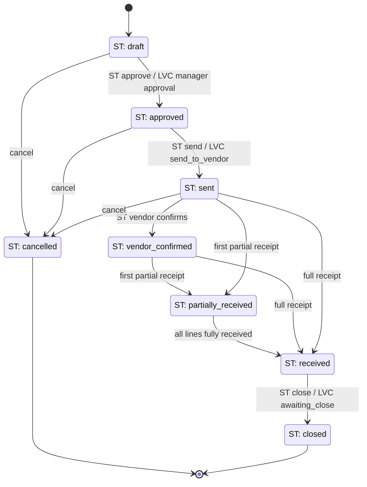
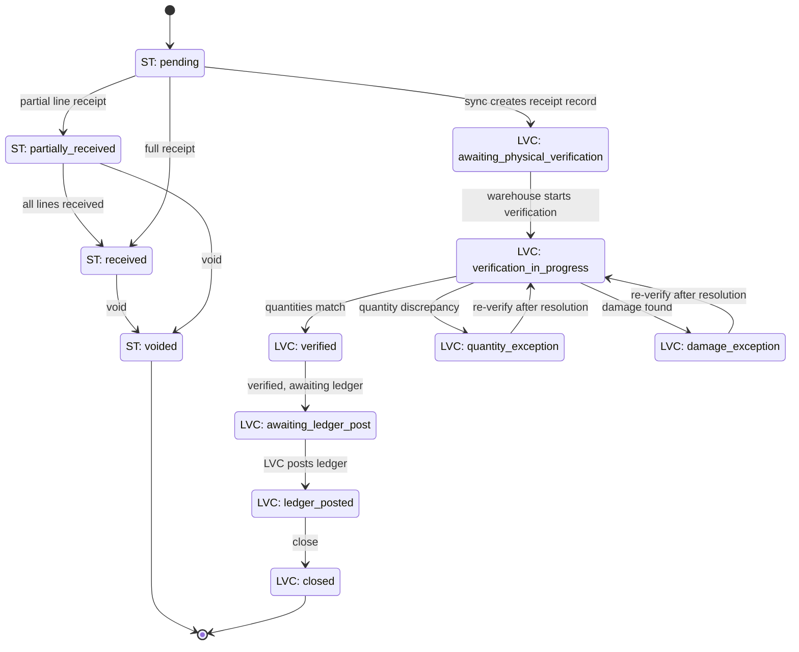
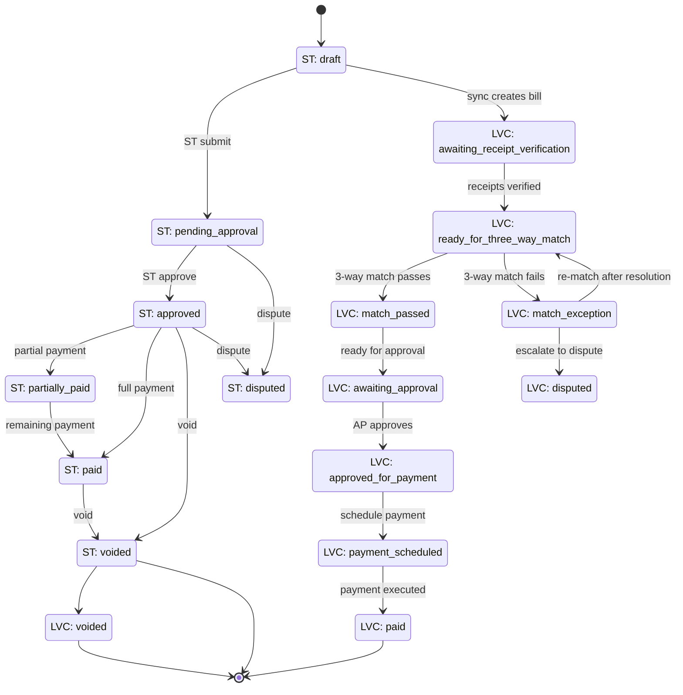
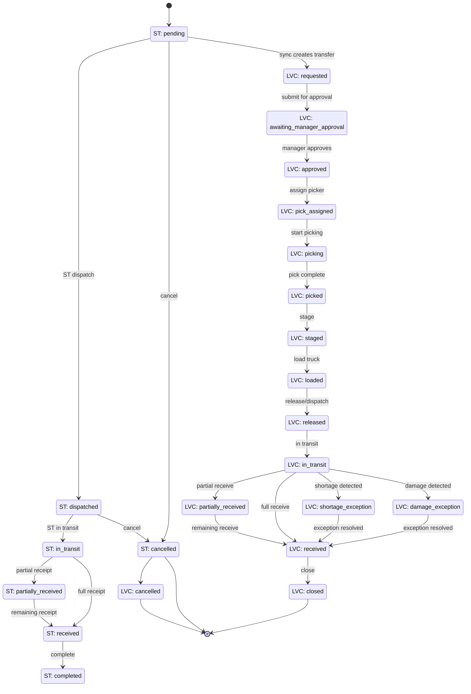
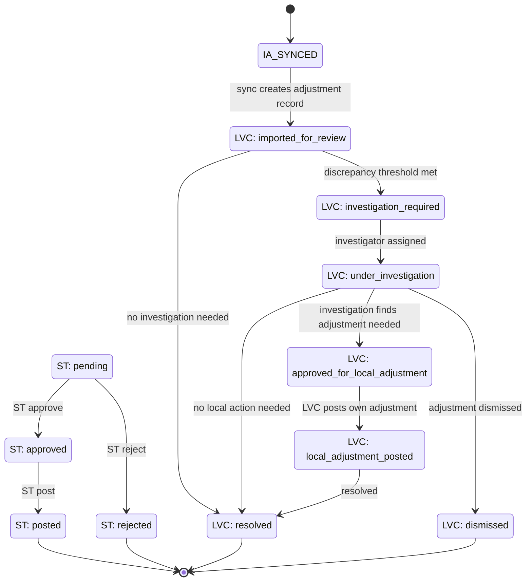

# STAGE 2E — PROCUREMENT LIFECYCLE AND STATE DIAGRAMS

**Status:** Architecture deliverable — awaiting owner review
**Date:** 2026-08-03

---

## CORE PRINCIPLE: THREE-STATUS SEPARATION

Every procurement entity maintains THREE independent status concepts:

1. **Source lifecycle status** (`status`) — ServiceTitan-owned, overwritten by inbound sync
2. **LVC workflow status** (`*_workflow_status` or equivalent LVC field) — LVC-owned, protected from sync
3. **Synchronization status** (`servicetitan_sync_status`) — Sync infrastructure status

These are NEVER combined into a single field. Sync overwrites `status` but never touches LVC workflow status.

**Governing Authority:** The architectural governance principles in `STAGE_2E_PROCUREMENT_ARCHITECTURE.md` §0 take precedence over all lifecycle decisions documented here. ServiceTitan is the external source; LVC OS is the operational system of record. Sync updates ST-owned fields only; all LVC-owned workflow, warehouse, and operational data is protected.

---

## 2A. PURCHASE ORDER LIFECYCLE

### 2A.1 Mermaid State Diagram

### 2A.2 Source Lifecycle Status Dictionary

| Status | Description | Owner | Overwritten by Sync |
|---|---|---|---|
| `draft` | PO created, not yet approved | ServiceTitan | YES |
| `approved` | Approved for sending to vendor | ServiceTitan | YES |
| `sent` | Sent to vendor | ServiceTitan | YES |
| `vendor_confirmed` | Vendor confirmed receipt of PO | ServiceTitan | YES |
| `partially_received` | At least one line partially received | ServiceTitan | YES |
| `received` | All lines fully received | ServiceTitan | YES |
| `closed` | PO closed (all receipts and bills settled) | ServiceTitan | YES |
| `cancelled` | PO cancelled | ServiceTitan | YES |

### 2A.3 LVC Workflow Status Dictionary

| Status | Description | Owner | Protected from Sync |
|---|---|---|---|
| `draft` | LVC-created draft (pre-sync) | LVC | YES |
| `awaiting_manager_approval` | Submitted for internal approval | LVC | YES |
| `approved_for_send` | Manager approved, ready to send | LVC | YES |
| `sent_to_vendor` | LVC sent the PO to vendor | LVC | YES |
| `awaiting_delivery` | Waiting for vendor delivery | LVC | YES |
| `partially_received` | LVC confirmed partial receipt | LVC | YES |
| `fully_received` | LVC confirmed all lines received | LVC | YES |
| `awaiting_close` | Receipts done, awaiting bill reconciliation | LVC | YES |
| `exception_review` | Discrepancy detected, under review | LVC | YES |
| `completed` | Fully closed in LVC | LVC | YES |
| `cancelled` | LVC-cancelled | LVC | YES |

**RESOLVED:** The `PurchaseOrder` schema now includes a dedicated `lvc_workflow_status` field with the full 11-value enum (draft, awaiting_manager_approval, approved_for_send, sent_to_vendor, awaiting_delivery, partially_received, fully_received, awaiting_close, exception_review, completed, cancelled). The narrower `approval_status` field is retained for the approval decision only.

### 2A.4 Synchronization Status Dictionary

| Status | Description |
|---|---|
| `pending` | Awaiting first sync or dependency resolution |
| `synced` | Last sync succeeded |
| `conflict` | Local/ST conflict recorded |
| `deferred` | Deferred — dependency not yet resolved |
| `failed` | Sync failed (non-retriable) |
| `deleted` | Soft-deleted by ServiceTitan |

**RESOLVED:** The `servicetitan_sync_status` enum now includes `deferred` and `failed` on all procurement entities.

### 2A.5 Transition Table

| From | To | Trigger | Actor | Automatic? | Blocked When |
|---|---|---|---|---|---|
| draft | approved | ST approval event | ServiceTitan | YES (webhook) | LVC approval_status = pending |
| approved | sent | ST send event | ServiceTitan | YES (webhook) | — |
| sent | vendor_confirmed | ST vendor confirm | ServiceTitan | YES (webhook) | — |
| sent | partially_received | First receipt sync | Sync Engine | YES | No local Receipt exists |
| partially_received | received | All lines received | Sync Engine | YES | Receipts incomplete |
| received | closed | ST close event | ServiceTitan | YES (webhook) | LVC bills not reconciled |
| draft | cancelled | Cancel event | ServiceTitan/LVC | Manual or auto | — |
| approved | cancelled | Cancel event | ServiceTitan/LVC | Manual or auto | — |
| sent | cancelled | Cancel event | ServiceTitan/LVC | Manual or auto | Partial receipts exist (block) |

### 2A.6 Actor/Role Matrix

| Transition | Admin | Manager | Buyer | System (Sync) |
|---|---|---|---|---|
| draft → approved | ALLOW | ALLOW | ALLOW | AUTO (ST webhook) |
| approved → sent | ALLOW | ALLOW | ALLOW | AUTO (ST webhook) |
| received → closed | ALLOW | ALLOW | BLOCK | AUTO (ST webhook) |
| * → cancelled | ALLOW | ALLOW | BLOCK | AUTO (ST cancel) |
| LVC approval (pending → approved) | ALLOW | ALLOW | BLOCK | NEVER |
| LVC exception review | ALLOW | ALLOW | ALLOW | NEVER |

### 2A.7 Automatic Trigger Table

| Trigger | Source | Effect |
|---|---|---|
| ST `purchase_order.approved` webhook | ServiceTitan | Update `status` to `approved` |
| ST `purchase_order.sent` webhook | ServiceTitan | Update `status` to `sent` |
| First `receipt.created` synced | Sync Engine | Update `status` to `partially_received` |
| All lines `quantity_received >= quantity_ordered` | Sync Engine | Update `status` to `received` |
| ST `purchase_order.closed` webhook | ServiceTitan | Update `status` to `closed` |
| ST `purchase_order.cancelled` webhook | ServiceTitan | Update `status` to `cancelled` |

### 2A.8 Notification Table

| Event | Recipients | Channel |
|---|---|---|
| PO approved | Buyer, Manager | In-app + Email |
| PO sent to vendor | Buyer | In-app |
| Partial receipt received | Buyer, Warehouse | In-app |
| Full receipt received | Buyer, Manager, AP | In-app + Email |
| PO closed | Buyer, Manager, AP | In-app |
| PO cancelled | Buyer, Manager | In-app + Email |
| Exception detected | Manager, Buyer | In-app + Email (urgent) |

### 2A.9 Exception Table

| Exception | Detection | Handling |
|---|---|---|
| Quantity mismatch | Receipt qty ≠ PO qty | LVC workflow → `exception_review` |
| Missing vendor | ST vendor ID not in local registry | DEFER record |
| Missing material | ST material ID not in local registry | DEFER line |
| Duplicate PO | Duplicate `servicetitan_purchase_order_id` | `safeCreateWithRecheck` → update instead |
| Cancelled with partial receipts | Cancel event while `partially_received` | BLOCK cancel, notify manager |

### 2A.10 Terminal-State Rules

| Terminal State | Reopening Allowed? | Conditions |
|---|---|---|
| `closed` | NO (unless ST reopens) | ST reopen event updates `status` back |
| `cancelled` | NO (unless ST reopens) | ST reopen event updates `status` back |

**Reopening rule:** Only ServiceTitan can reopen a closed or cancelled PO. LVC cannot reopen. A ST reopen event sets `status` back to the ST-provided value and clears `closed_at`/`cancelled_at`.

---

## 2B. RECEIPT LIFECYCLE

### 2B.1 Mermaid State Diagram

### 2B.2 Source Lifecycle Status Dictionary

| Status | Description | Owner |
|---|---|---|
| `pending` | Receipt created, not yet fully processed | ServiceTitan |
| `partially_received` | Some lines received, some pending | ServiceTitan |
| `received` | All lines received | ServiceTitan |
| `voided` | Receipt voided (reversed) | ServiceTitan |

### 2B.3 LVC Workflow Status Dictionary

| Status | Description | Owner | Ledger Effect |
|---|---|---|---|
| `awaiting_physical_verification` | Sync created record, awaiting warehouse check | LVC | NONE |
| `verification_in_progress` | Warehouse is physically counting | LVC | NONE |
| `verified` | Physical count matches receipt | LVC | NONE |
| `quantity_exception` | Received qty ≠ expected qty | LVC | NONE |
| `damage_exception` | Damaged items found | LVC | NONE |
| `awaiting_ledger_post` | Verified, awaiting ledger posting | LVC | NONE |
| `ledger_posted` | Inventory ledger updated | LVC | **INCREASE** warehouse inventory |
| `closed` | Fully processed and closed | LVC | NONE |

### 2B.4 Synchronization Status Dictionary

| Status | Description |
|---|---|
| `pending` | Awaiting sync or dependency resolution |
| `synced` | Last sync succeeded |
| `conflict` | Local/ST conflict |
| `deferred` | Dependency not resolved |
| `failed` | Non-retriable failure |
| `deleted` | Soft-deleted by ST |

### 2B.5 Transition Table

| From | To | Trigger | Actor | Automatic? |
|---|---|---|---|---|
| (new) | awaiting_physical_verification | Receipt sync creates record | Sync Engine | YES |
| awaiting_physical_verification | verification_in_progress | Warehouse starts count | Warehouse Worker | Manual |
| verification_in_progress | verified | Count matches | Warehouse Worker | Manual |
| verification_in_progress | quantity_exception | Count ≠ expected | Warehouse Worker | Manual |
| verification_in_progress | damage_exception | Damage found | Warehouse Worker | Manual |
| quantity_exception | verification_in_progress | Re-verify after resolution | Warehouse Worker | Manual |
| damage_exception | verification_in_progress | Re-verify after damage report | Warehouse Worker | Manual |
| verified | awaiting_ledger_post | Verified, queue ledger | System | YES |
| awaiting_ledger_post | ledger_posted | LVC posts inventory ledger | System (LVC workflow) | YES (after verification) |
| ledger_posted | closed | Close receipt | System | YES |

### 2B.6 Critical Rule: No Silent Ledger Posting

**Receipt synchronization MUST NOT post inventory ledger entries.** The sync creates the `Receipt` record and populates ST-owned fields. LVC's physical-verification workflow controls when the ledger is posted.

| Layer | Action | Ledger Effect |
|---|---|---|
| Sync Engine | Creates Receipt record | NONE |
| LVC Workflow (awaiting_physical_verification) | Waits for warehouse | NONE |
| LVC Workflow (verified) | Marks verified | NONE |
| LVC Workflow (ledger_posted) | Posts InventoryTransaction | **INCREASE** warehouse qty |

### 2B.7 Bill-Creation Eligibility

A Bill can reference a Receipt only after:
- Receipt LVC workflow status = `verified` or `ledger_posted`
- Receipt is not `voided`

### 2B.8 Void Behavior

When ServiceTitan voids a receipt:
- ST status → `voided`
- LVC workflow status preserved (for audit)
- If ledger was posted, a reversal ledger entry is created by LVC workflow (not by sync)
- Linked Bill lines are flagged for review

### 2B.9 Reinspection Path

If a verified receipt later proves incorrect:
1. LVC workflow → `quantity_exception` or `damage_exception`
2. If ledger was posted, reversal entry created by LVC workflow
3. Re-verify → `verified` → `awaiting_ledger_post` → `ledger_posted` (with corrected entry)

---

## 2C. BILL LIFECYCLE

### 2C.1 Mermaid State Diagram

### 2C.2 Source Lifecycle Status Dictionary

| Status | Description | Owner |
|---|---|---|
| `draft` | Bill created in ST, not yet submitted | ServiceTitan |
| `pending_approval` | Submitted for approval in ST | ServiceTitan |
| `approved` | Approved in ST | ServiceTitan |
| `partially_paid` | Partially paid | ServiceTitan |
| `paid` | Fully paid | ServiceTitan |
| `voided` | Voided | ServiceTitan |
| `disputed` | Disputed | ServiceTitan |

### 2C.3 LVC Workflow Status Dictionary

| Status | Description | Owner | Inventory Effect |
|---|---|---|---|
| `awaiting_receipt_verification` | Bill synced, awaiting receipt verification | LVC | NONE |
| `ready_for_three_way_match` | Receipts verified, ready for 3WM | LVC | NONE |
| `match_passed` | PO + Receipt + Bill quantities match | LVC | NONE |
| `match_exception` | 3WM failed (qty/price mismatch) | LVC | NONE |
| `awaiting_approval` | 3WM passed, awaiting AP approval | LVC | NONE |
| `approved_for_payment` | AP approved payment | LVC | NONE |
| `payment_scheduled` | Payment scheduled | LVC | NONE |
| `paid` | Payment executed | LVC | NONE |
| `disputed` | Escalated to dispute | LVC | NONE |
| `voided` | LVC voided | LVC | NONE |

### 2C.4 Three-Way Match

| Match Element | Source A | Source B | Match Field |
|---|---|---|---|
| Quantity | PO Line `quantity_ordered` | Bill Line `quantity_billed` | Must be ≤ |
| Quantity | Receipt Line `quantity_received` | Bill Line `quantity_billed` | Must be ≤ |
| Price | PO Line `unit_cost` | Bill Line `unit_cost` | Must match (or within tolerance) |
| Vendor | PO `servicetitan_vendor_id` | Bill `servicetitan_vendor_id` | Must match |

### 2C.5 Critical Rule: Bills Never Change Inventory

**Bills represent AP obligations only. Bills do NOT create inventory ledger entries.** Inventory was already increased when the Receipt was verified and posted.

### 2C.6 Duplicate Invoice Detection

Before creating a Bill, check for existing bills with the same `vendor_invoice_number` + `servicetitan_vendor_id`. If found:
- Flag as potential duplicate
- Route to `match_exception` LVC workflow
- Do NOT auto-create duplicate

---

## 2D. WAREHOUSE TRANSFER LIFECYCLE

### 2D.1 Mermaid State Diagram

### 2D.2 Ledger Timing Rules

| Event | Ledger Effect | Timing |
|---|---|---|
| Release/Dispatch confirmed | **DECREASE** source warehouse qty | At LVC `released` state |
| Release/Dispatch confirmed | **INCREASE** in-transit qty | At LVC `released` state |
| Receipt confirmed | **DECREASE** in-transit qty | At LVC `received` state |
| Receipt confirmed | **INCREASE** destination warehouse qty | At LVC `received` state |

**Critical:** Destination inventory increases ONLY at receipt confirmation, not at dispatch.

### 2D.3 Exception Handling

| Exception | Detection | Handling |
|---|---|---|
| Shortage (received < dispatched) | `quantity_received < quantity_dispatched` | LVC → `shortage_exception` |
| Damage | Condition at receipt = `damaged`/`lost` | LVC → `damage_exception` |
| Lost in transit | No receipt after expected arrival | LVC → `shortage_exception` |
| Cancellation after dispatch | Cancel event while `in_transit` | BLOCK, notify manager |

---

## 2E. INVENTORY ADJUSTMENT LIFECYCLE

### 2E.1 Mermaid State Diagram

### 2E.2 Critical Rule: Read-Only from ServiceTitan

**ServiceTitan adjustments are synchronized for audit visibility ONLY. They do NOT directly alter the LVC inventory ledger.**

| Layer | Action | Ledger Effect |
|---|---|---|
| Sync Engine | Creates InventoryAdjustment record | NONE |
| LVC Workflow (imported_for_review) | Waits for review | NONE |
| LVC Workflow (approved_for_local_adjustment) | Approves local adjustment | NONE |
| LVC Workflow (local_adjustment_posted) | LVC posts own InventoryTransaction | **ADJUST** qty (increase/decrease) |

The `ledger_posted` flag on `InventoryAdjustment` tracks whether LVC has posted its own independent adjustment. ST's `posted_at` tracks when ST posted — these are independent.

### 2E.3 Investigation Workflow

| Trigger | Threshold | Auto-Route |
|---|---|---|
| `quantity_adjustment` > X units | Configurable | `investigation_required` |
| `cost_impact` > $Y | Configurable | `investigation_required` |
| `adjustment_type` = `loss` or `shrinkage` | Always | `investigation_required` |
| All other adjustments | Default | `imported_for_review` → `resolved` |

---

## CROSS-ENTITY SYNCHRONIZATION STATUS

All procurement entities (PurchaseOrder, PurchaseOrderLine, Receipt, ReceiptLine, Bill, BillLine, WarehouseTransfer, WarehouseTransferLine, InventoryAdjustment, BillReceiptLink) share the same synchronization status enum:

| Status | Description | Set By |
|---|---|---|
| `pending` | Awaiting first sync or dependency resolution | Sync Engine |
| `synced` | Last sync succeeded | Sync Engine |
| `conflict` | Local/ST conflict recorded | Sync Engine |
| `deferred` | Dependency not resolved | Dependency Resolver |
| `failed` | Non-retriable failure | Sync Engine |
| `deleted` | Soft-deleted by ServiceTitan | Sync Engine |

**RESOLVED:** All procurement entity schemas now include `deferred` and `failed` in the `servicetitan_sync_status` enum.