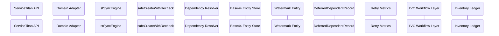
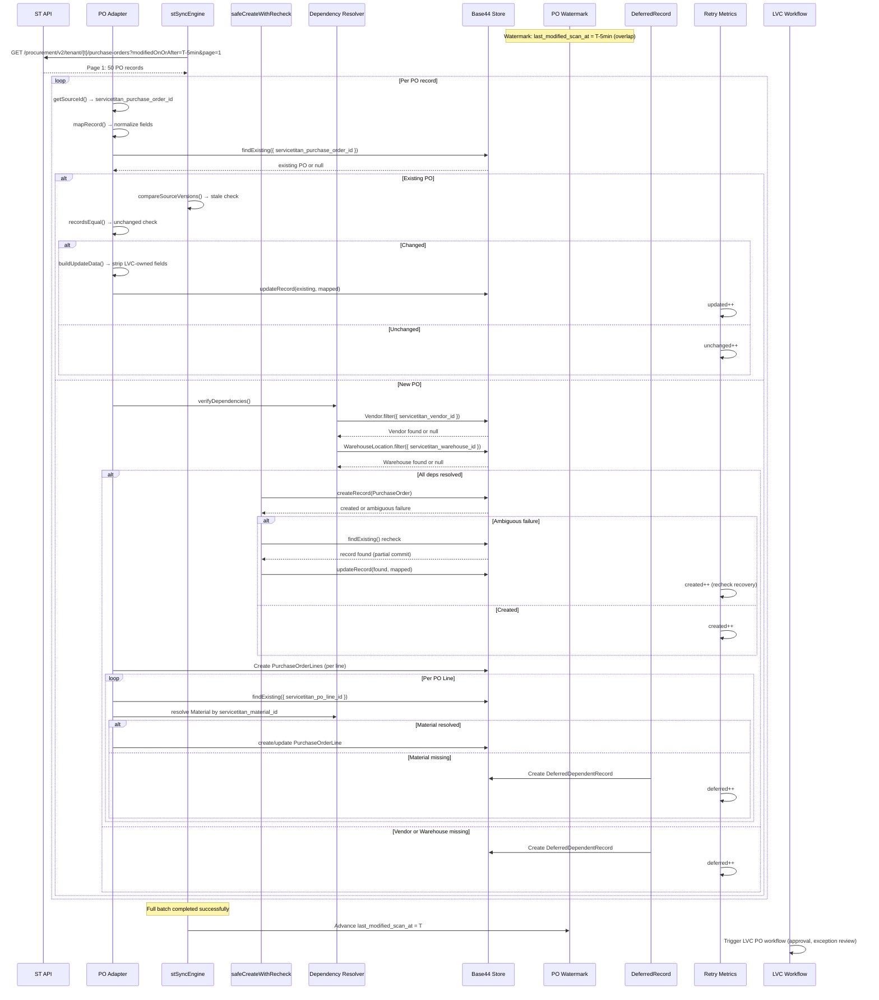
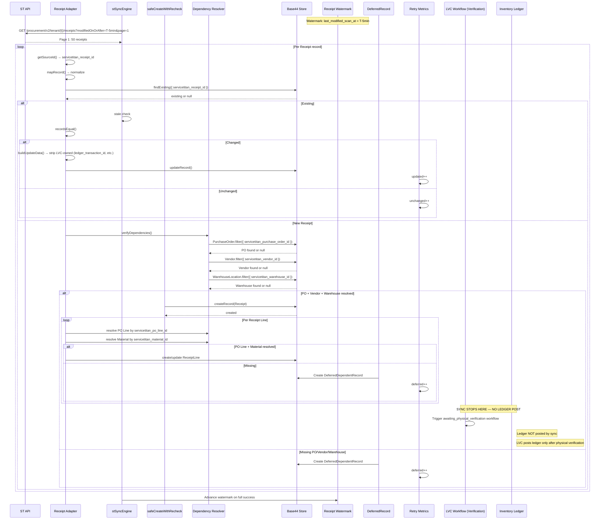
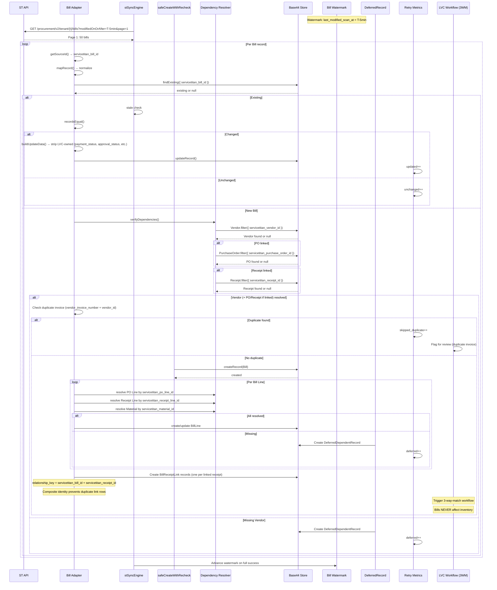
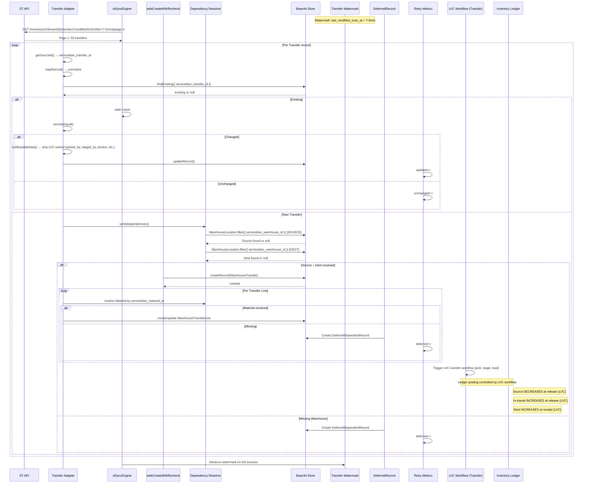
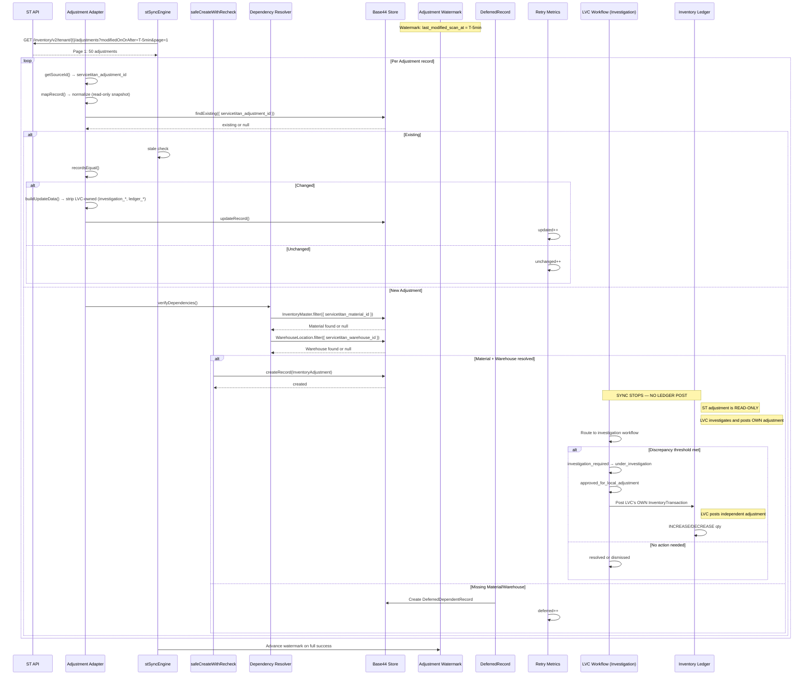

# STAGE 2E — PROCUREMENT SYNCHRONIZATION SEQUENCE DIAGRAMS

**Status:** Architecture deliverable — awaiting owner review
**Date:** 2026-08-03

---

## SHARED SEQUENCE INFRASTRUCTURE

Every procurement domain sequence follows the same shared pipeline:



### Header-First Line Synchronization Rule

Headers may arrive before lines because of separate endpoints, pagination, API expansion rules, delayed dependency availability, partial API responses, or transient line-fetch failures. Required behavior:

- Create or update the header (header identity and valid header data are sufficient)
- Mark line synchronization incomplete (`lines_sync_status = partial` or `pending`)
- Defer line processing (lines retried in next sync cycle)
- Do NOT classify the header as invalid solely because lines are temporarily unavailable
- Header remains eligible for line retry
- Watermark logic preserves resumability

### Universal Sequence Steps (All Domains)

| # | Step | Component | Action | Ledger Effect |
|---|---|---|---|---|
| 1 | API page fetch | ADP → API | `fetchPage()` with `modifiedOnOrAfter` + overlap window | NONE |
| 2 | Record mapping | ADP | `mapRecord()` — extract + normalize fields | NONE |
| 3 | Immutable ID extraction | ADP | `getSourceId()` — extract `servicetitan_*_id` | NONE |
| 4 | Existing-record lookup | ADP → B44 | `findExisting()` by immutable ID | NONE |
| 5 | Stale-event check | ENG | `compareSourceVersions()` — older event skipped | NONE |
| 6 | Dependency verification | ADP → DEP → B44 | `verifyDependencies()` — resolve FK dependencies | NONE |
| 7 | Ownership-filtered update | ADP | `buildUpdateData()` — strip LVC-owned fields | NONE |
| 8a | Safe create (header) | SAFE → B44 | `safeCreateWithRecheck()` for new headers | NONE |
| 8b | Update (header) | ADP → B44 | `updateRecord()` for existing headers | NONE |
| 8c | Line sync status | ADP → B44 | Set `lines_sync_status` (not_started/pending/partial/complete/failed) | NONE |
| 9 | Post-create recheck | SAFE → B44 | Re-`findExisting()` after ambiguous create failure | NONE |
| 10 | Line processing | ADP → B44 | Create/update lines (may be deferred or pending) | NONE |
| 10b | BillReceiptLink (Bill only) | ADP → B44 | Create `BillReceiptLink` per linked receipt | NONE |
| 11 | Retry classification | RT | Classify: `created` / `updated` / `unchanged` / `deferred` / `failed` | NONE |
| 12 | Deferred handling | DEF | Create `DeferredDependentRecord` for unresolved deps | NONE |
| 13 | Watermark advancement | ENG → WM | Advance `last_modified_scan_at` ONLY on full success | NONE |
| 14 | LVC workflow trigger | LVC | Trigger LVC workflow (physical verification, 3WM, etc.) | NONE |
| 15 | Ledger side-effect | LED | LVC workflow posts ledger (NOT sync) | DOMAIN-SPECIFIC |

---

## 1. PURCHASE ORDER IMPORT SEQUENCE



### Step-by-Step Flow (Purchase Order)

| Step | Action | Failure Path | Ledger Effect |
|---|---|---|---|
| 1 | Fetch PO page from ST API | Retry 3x with backoff | NONE |
| 2 | Extract `servicetitan_purchase_order_id` | Skip record if missing | NONE |
| 3 | Map PO fields (normalize, strip LVC-owned) | Skip if mapping fails | NONE |
| 4 | Lookup existing PO by ST ID | — | NONE |
| 5 | Stale-event check (modifiedOn comparison) | Skip if older | NONE |
| 6 | Resolve Vendor by `servicetitan_vendor_id` | DEFER if missing | NONE |
| 7 | Resolve Warehouse by `servicetitan_warehouse_id` | DEFER if missing | NONE |
| 8 | Safe create PO (with recheck) | Recheck → update if partial commit | NONE |
| 9 | For each line: resolve Material by `servicetitan_material_id` | DEFER line if missing | NONE |
| 10 | Safe create/update each PurchaseOrderLine | Recheck → update | NONE |
| 11 | Record retry metrics | — | NONE |
| 12 | Advance watermark (only on full success) | NO advancement on partial | NONE |
| 13 | Trigger LVC PO workflow | — | NONE (LVC controls) |

---

## 2. RECEIPT IMPORT SEQUENCE



### Receipt Ledger Side-Effect Point

| Phase | Who | Ledger Effect |
|---|---|---|
| Sync creates Receipt | Sync Engine | **NONE** |
| LVC: awaiting_physical_verification | LVC Workflow | **NONE** |
| LVC: verification_in_progress | LVC Workflow | **NONE** |
| LVC: verified | LVC Workflow | **NONE** |
| LVC: awaiting_ledger_post | LVC Workflow | **NONE** |
| LVC: ledger_posted | **LVC Workflow** | **INCREASE warehouse inventory** |

**The sync NEVER calls the inventory ledger. Only LVC's physical-verification workflow posts ledger entries after a human has verified the physical count.**

---

## 3. BILL IMPORT SEQUENCE



### Bill Ledger Side-Effect Point

| Phase | Who | Ledger Effect |
|---|---|---|
| Sync creates Bill | Sync Engine | **NONE** |
| LVC: three-way match | LVC Workflow | **NONE** |
| LVC: approved_for_payment | LVC Workflow | **NONE** |
| LVC: paid | LVC Workflow | **NONE** (AP payment, not inventory) |

**Bills NEVER create inventory ledger entries. Inventory was already increased at receipt verification.**

---

## 4. TRANSFER IMPORT SEQUENCE



### Transfer Ledger Timing Rules

| Event | Source Qty | In-Transit Qty | Dest Qty | Who Posts |
|---|---|---|---|---|
| Sync creates Transfer | UNCHANGED | UNCHANGED | UNCHANGED | Sync (NO ledger) |
| LVC: released (dispatch) | DECREASE | INCREASE | UNCHANGED | LVC Workflow |
| LVC: in_transit | UNCHANGED | UNCHANGED | UNCHANGED | — |
| LVC: received | UNCHANGED | DECREASE | INCREASE | LVC Workflow |

**Sync NEVER posts transfer ledger entries. LVC's physical-workflow layer posts ledger entries at release and receipt confirmation.**

---

## 5. INVENTORY ADJUSTMENT IMPORT SEQUENCE



### Adjustment Ledger Side-Effect Point

| Phase | Who | Ledger Effect |
|---|---|---|
| Sync creates Adjustment | Sync Engine | **NONE** |
| LVC: imported_for_review | LVC Workflow | **NONE** |
| LVC: investigation | LVC Workflow | **NONE** |
| LVC: approved_for_local_adjustment | LVC Workflow | **NONE** |
| LVC: local_adjustment_posted | **LVC Workflow** | **ADJUST** (increase/decrease) |

**The sync NEVER posts adjustment ledger entries. LVC posts its own independent adjustment after investigation. The `ledger_posted` flag tracks LVC's posting, independent of ST's `posted_at`.**

---

## WATERMARK ADVANCEMENT DECISION TABLE

| Condition | Watermark Advanced? | Resume Boundary |
|---|---|---|
| All records processed successfully | YES — `last_modified_scan_at = windowEnd` | Next batch starts from new watermark |
| Some records deferred (deps unresolved) | YES — deferred records retried next cycle | Deferred records retried, not blocking |
| Some records permanently failed | NO — stop | Resume from same `last_modified_scan_at` |
| Rate-limited unresolved | NO — stop | Resume from same watermark |
| Runtime limit hit (partial batch) | NO — stop | Resume from same watermark |
| Page limit hit | NO — stop | Resume from same watermark |
| Zero records to process (all unchanged) | YES — idempotent advance | Next batch starts from new watermark |
| Ambiguous create failure (partial commit) | YES if recovered | `safeCreateWithRecheck` recovers → no duplicate |

### Advancement Rule

**Watermark advances ONLY after a full recovery window completes successfully (all records processed, zero permanent failures, zero rate-limited-unresolved).** Partial batches do NOT advance the watermark. The next batch re-fetches from the same window and detects already-created records as `unchanged`.

---

## RETRY DECISION TABLE

| Error Type | Retry? | Max Retries | Backoff | Classification |
|---|---|---|---|---|
| HTTP 429 (rate limit) | YES | 5 | Exponential + `Retry-After` | `rate_limited_unresolved` if exhausted |
| HTTP 5xx | YES | 5 | Exponential + jitter | `permanently_failed` if exhausted |
| Network timeout | YES | 5 | Exponential + jitter | `permanently_failed` if exhausted |
| Ambiguous create failure | YES (recheck) | 5 | Immediate recheck | `created` or `updated` (recheck recovery) |
| Dependency not found | NO (defer) | — | Next sync cycle | `deferred` |
| Invalid record (missing ID) | NO | — | — | `permanently_failed` |
| Mapping failure | NO | — | — | `permanently_failed` |
| Schema validation error | NO | — | — | `permanently_failed` |

---

## OWNERSHIP ENFORCEMENT POINT

Every sequence enforces ownership at **Step 7 (buildUpdateData)**:

```
buildUpdateData(existing, mapped, nowIso):
  1. Start with empty update object
  2. For each ST-owned field: if mapped value differs, add to update
  3. For each LVC-owned field: NEVER add to update (even if mapped has value)
  4. Strip any LVC-owned fields that accidentally appear
  5. Return update object (null if no changes)
```

| Layer | Enforcement |
|---|---|
| Adapter `mapRecord()` | Maps ST fields only, never sets LVC-owned fields |
| Adapter `buildUpdateData()` | Strips LVC-owned fields from update payload |
| Domain service `assertNoLvcFieldWritten()` | Validates no LVC fields in update |
| Post-sync verification | Checks `lvc_owned_field_overwrites === 0` |

---

## LEDGER SIDE-EFFECT POINT SUMMARY

| Domain | Sync Posts Ledger? | LVC Posts Ledger? | When? |
|---|---|---|---|
| Purchase Order | NO | NO (PO has no ledger effect) | N/A |
| Receipt | **NO** | **YES** | After physical verification (LVC workflow) |
| Bill | NO | NO (AP only, no inventory) | N/A |
| Transfer | **NO** | **YES** | At release (source decrease) + at receipt (dest increase) |
| Inventory Adjustment | **NO** | **YES** | After investigation + local approval (LVC workflow) |

**The sync engine NEVER posts inventory ledger entries. Ledger posting is exclusively controlled by LVC workflow layers after human verification.**